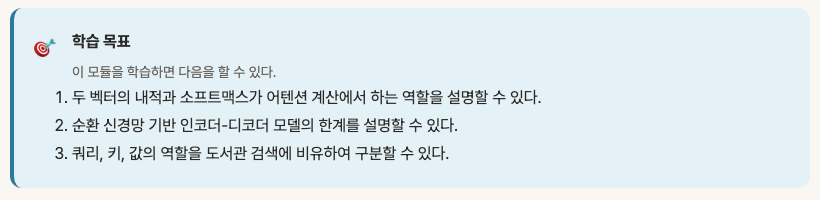
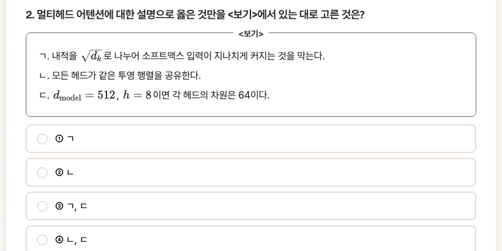
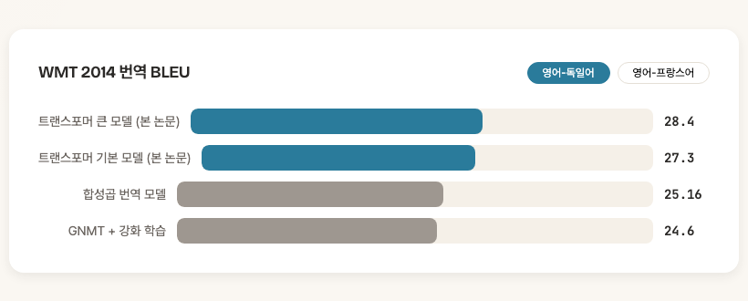

# Paper-to-Course · 한국어판

논문 PDF나 arXiv 링크를 주면 **EBS 교재처럼 읽히는 한국어 인터랙티브 강의**를 만들어 주는 Claude Code 스킬입니다.

<p align="center">
  
</p>

<p align="center">
  <sub>위 화면은 <a href="examples/attention-ko/"><code>examples/attention-ko/</code></a>의 실제 결과물입니다. <code>index.html</code>을 브라우저로 열면 바로 볼 수 있습니다.</sub>
</p>

---

## 바로 써 보기

**1. 설치**: 스킬 폴더에 이 저장소를 복제합니다.

```bash
git clone https://github.com/genelyuu/paper-to-course.git ~/.claude/skills/paper-to-course
```

**2. 요청**: Claude Code에서 논문과 함께 말합니다.

```text
./paper.pdf로 강의 만들어 줘
https://arxiv.org/abs/1706.03762 쉽게 설명해 줘
```

**3. 열기**: 생성된 강의 폴더의 `index.html`을 브라우저로 엽니다. 서버나 빌드 도구는 필요 없습니다.

---

## 강의는 이렇게 생겼습니다

| 모듈마다 학습 목표로 시작합니다 | 문항은 교재 형식을 따릅니다 |
|:--:|:--:|
|  |  |
| **수치는 직접 바꿔 가며 비교합니다** | |
|  | |

한 강의에는 이런 요소가 들어갑니다.

- 단계별 수식 유도(KaTeX)와 한 줄씩 해설하는 의사코드
- 지표를 바꿔 가며 보는 결과 비교 막대, 구성 요소를 끄고 켜는 제거 실험
- 연구 계보 트리, 연구자 대화, 흐름 다이어그램
- 객관식·끌어 놓기 퀴즈와 전문 용어 툴팁

---

## 원본과 무엇이 다른가

[ZeroxZhang/paper-to-course](https://github.com/ZeroxZhang/paper-to-course)는 중국어 강의를 만듭니다. 이 포크는 한국어 학습자를 위해 글, 글꼴, 검증을 바꿨습니다.

| | 원본 | 이 포크 |
|---|---|---|
| 출력 언어 | 중국어 | 한국어(`<html lang="ko">`) |
| 본문 문체 | 정해진 규칙 없음 | EBS 교재 한다체(`~이다`, `~한다`) |
| 모듈 구성 | 정해진 규칙 없음 | 학습 목표 → 개념 체크 → 탐구 자료 → 핵심 정리 → 확인 문제 |
| 문항과 해설 | 정해진 규칙 없음 | `다음 중 ~으로 옳은 것은?`, ①~⑤, `<보기>` / 해설은 `② \| ~이므로 ~이다.` |
| 글꼴 | DM Sans, Bricolage Grotesque | Pretendard, 어절 단위 줄바꿈(`keep-all`) |
| 용어 | 용어 사전 없음 | 용어 사전 243개 + 강의별 용어표로 번역어 고정 |
| 검증 | 없음 | `lint-ko.py` 14개 규칙 |

원본 `main.js`의 버그도 함께 고쳤습니다.

- 초기화 순서 오류로 스크립트가 멈춰 **퀴즈를 비롯한 모든 인터랙션이 동작하지 않던** 문제
- 퀴즈 해설 안의 `$수식$`이 그대로 보이던 문제
- 결과 막대가 BLEU처럼 백분율이 아닌 지표에도 `%`를 붙이던 문제(`data-unit`, `data-max`로 해결)

---

## 한국어 검증

스킬은 강의를 다 만든 뒤 검증 도구를 돌립니다. 직접 돌릴 수도 있습니다.

```bash
python3 references/lint-ko.py <강의 폴더> --strict
```

| 등급 | 잡아내는 것 |
|---|---|
| 오류 | 중국어·한자 잔존, 중국어식 전각 문장부호, `lang` 누락, 깨진 `data-steps` JSON |
| 경고 | 문체 섞임, 번역투(`~에 의해`, `~를 가지다`), 약어 뒤 조사, 숫자·단위 띄어쓰기, 칭찬형 해설, 정답 표시 중복 |

규칙별 근거는 [`references/korean-style-guide.md`](references/korean-style-guide.md)에 있습니다.

---

## 안에 든 것

```text
SKILL.md                      스킬 정의: 5단계 작업 절차와 EBS 문체 규칙
references/
  korean-style-guide.md       문체·조사·띄어쓰기·번역투 규칙
  glossary-ko.md              AI·ML 용어 번역 사전(243개)
  lint-ko.py                  한국어 출력 검증 도구(표준 라이브러리만 사용)
  interactive-elements.md     인터랙티브 요소 18종의 HTML 패턴
  styles.css, main.js         강의에 그대로 복사되는 디자인과 동작
examples/attention-ko/        예시 강의(모듈 3개)
docs/
  PLAN.md, WORKLOG.md         한국어화 계획과 작업 기록
  research/                   참고 자료 조사(출처 포함)
```

<details>
<summary>스킬이 강의를 만드는 순서</summary>

1. **정독**: 논문을 세 번 읽고 수식, 결과, 데이터셋을 뽑습니다.
2. **배경 보강**: 웹 검색으로 선수 개념과 관련 연구를 채웁니다.
3. **설계**: 배경 → 문제 → 핵심 통찰 → 방법 → 실험 → 시사점 순서로 모듈을 짜고, 강의 용어표를 만듭니다.
4. **작성**: 모듈별로 HTML을 쓰고 `build.sh`로 `index.html` 하나로 합칩니다. 모듈이 많으면 하위 에이전트가 나눠 씁니다.
5. **검토**: `lint-ko.py --strict`와 체크리스트로 확인한 뒤 브라우저로 엽니다.

</details>

<details>
<summary>스킬 전체 개요 그림</summary>

<p align="center">
  
</p>

</details>

---

## 크레딧

- 원본 스킬: [ZeroxZhang/paper-to-course](https://github.com/ZeroxZhang/paper-to-course). 원본은 이후 [zerox-skills](https://github.com/ZeroxZhang/zerox-skills/tree/main/zerox-paper-to-course)로 옮겨졌습니다.
- 영감: [codebase-to-course](https://github.com/zarazhangrui/codebase-to-course)

[Apache License 2.0](LICENSE). 원저작자의 저작권 표시를 그대로 유지합니다.
