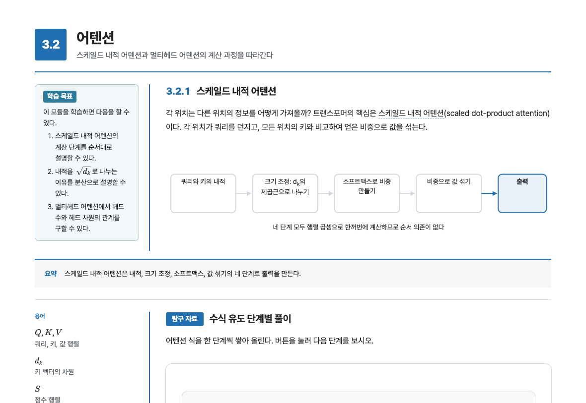
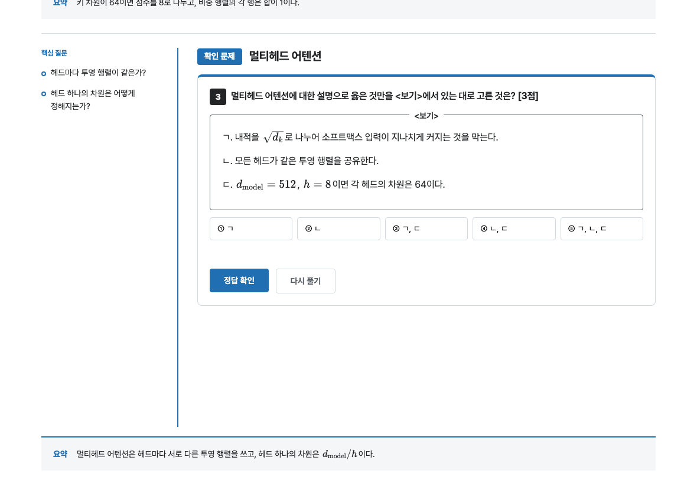
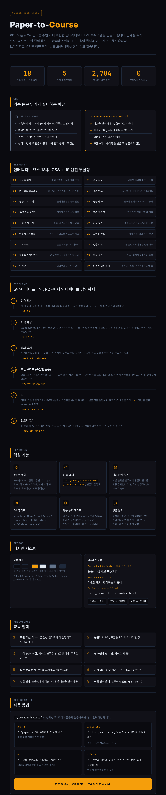

<div align="center">

# Paper-to-Course 한국어판

**논문 한 편을, 수능특강처럼 읽히는 한국어 인터랙티브 강의로.**

arXiv 링크나 PDF를 주면 Claude Code가 논문을 읽고<br>
교재 지면 · 학습서 문체 · 확인 문제까지 갖춘 강의 한 권을 만듭니다.

<a href="examples/attention-ko/"></a>


<a href="LICENSE"></a>

<br><br>


<sub>실제 결과물 <a href="examples/attention-ko/"><code>examples/attention-ko/</code></a> · <code>index.html</code>을 브라우저로 열면 바로 볼 수 있습니다</sub>

</div>

<br>

## 세 줄 요약

<table>
<tr>
<td width="33%" valign="top">

### 📐 지면은 교재처럼

화면 하나가 교재 한 페이지입니다. 코넬식 노트(단서 · 노트 · 요약)로 나누고, 1440×900에서 **스크롤 없이** 한눈에 들어오는지 도구로 잽니다.

</td>
<td width="33%" valign="top">

### ✍️ 글은 학습서처럼

본문은 한다체, 용어 뜻풀이는 사전식 명사형, 지시는 `~하시오`, 풀이 전략은 `~하라.` 실제 학습서 **192쪽의 문장 종결을 세어** 정한 규칙입니다.

</td>
<td width="33%" valign="top">

### 📄 목차는 논문 그대로

모듈과 화면 제목에 논문의 절 번호를 씁니다. `3.2 어텐션` → `3.2.1 스케일드 내적 어텐션`. 강의를 읽고 나면 원문 어디를 봤는지 바로 압니다.

</td>
</tr>
</table>

<br>

## 시작하기

```bash
# 1. 스킬 폴더에 설치
git clone https://github.com/genelyuu/paper-to-course.git ~/.claude/skills/paper-to-course
```

```text
# 2. Claude Code에서 요청
https://arxiv.org/abs/1706.03762 강의로 만들어 줘
./paper.pdf 쉽게 설명해 줘
```

**3.** 만들어진 폴더의 `index.html`을 엽니다. 서버도 빌드 도구도 필요 없습니다.

<br>

## 한 페이지는 이렇게 생겼습니다

<p align="center">
  
</p>

<table>
<tr>
<td width="34%" valign="top"><b>왼쪽 · 단서 칸</b><br>이 페이지가 답하는 질문, 용어, 학습 목표. 수능특강의 날개 자리입니다.</td>
<td width="33%" valign="top"><b>오른쪽 · 노트 칸</b><br>논문 절 번호를 단 본문, 다이어그램, 탐구 자료.</td>
<td width="33%" valign="top"><b>아래 · 요약 칸</b><br>페이지 전체를 한 문장으로.</td>
</tr>
</table>

<br>

| 확인 문제는 시험지처럼 | 탐구 자료는 직접 조작하며 |
|:--:|:--:|
|  |  |
| `<보기>`에서 있는 대로 고른 것은? [3점]<br>해설은 정답 근거 + 오답 하나 분석 | 지표 전환, 제거 실험 토글,<br>단계별 수식 유도 |

<br>

## 문체는 데이터로 정했습니다

EBS·교육 회사 학습서는 한 권 안에서도 **글의 역할마다 어미를 바꿉니다.** 공개된 학습서 본문을 추출해 종결 유형을 세고, 그 분화를 그대로 규칙으로 옮겼습니다.

| 글의 역할 | 학습서에서 센 수 | 강의에서 쓰는 형태 |
|---|--:|---|
| 개념 설명 | 한다체 **379** | 어텐션은 쿼리와 키의 내적으로 비중을 정한다. |
| 문항 지시 | `~하시오` **120** | 버튼을 눌러 다음 단계를 보시오. |
| 풀이 전략 | `~하라` **51** | 나누는 값을 묻는 문항은 분산이 아니라 그 제곱근인지 확인하라. |
| 용어 뜻풀이 | 명사형 **34** | 소프트맥스(softmax): 실수 여러 개를 모두 양수이고 합이 1인 값으로 바꾸는 함수. |
| 오답 해설 | 선지별 분석 | 정답은 ③이다. … ⑤는 분산 64를 그대로 쓴 값이므로 옳지 않다. |
| 머리말·사용법 | 합니다체 137 · 해요체 50 | **쓰지 않음** (강의 본문이 아니므로) |

<sub>표본: 지학사 『자신 있어, 어휘』 1·2단계, 『중등 수능 독해』 Level 2 (192쪽). 수집 과정과 출처는 <a href="docs/research/korean-references.md"><code>docs/research/korean-references.md</code></a> §9.</sub>

<br>

## 원본과 무엇이 다른가

[ZeroxZhang/paper-to-course](https://github.com/ZeroxZhang/paper-to-course)는 중국어 강의를 만듭니다. 이 포크는 한국어 학습자를 위해 글, 지면, 검증을 새로 짰습니다.

| | 원본 | 이 포크 |
|---|---|---|
| **언어** | 중국어 | 한국어 (`<html lang="ko">`) |
| **문체** | 규칙 없음 | 역할별 학습서 문체 (위 표) |
| **목차** | 교재식 모듈 제목 | 논문의 절 번호와 제목 |
| **모듈 흐름** | 규칙 없음 | 학습 목표 → 개념 체크 → 탐구 자료 → 핵심 정리 → 확인 문제 |
| **문항** | 규칙 없음 | `다음 중 ~으로 옳은 것은?` · ①~⑤ · `<보기>` · [3점] |
| **지면** | 베이지 바탕, 그림자 카드, 긴 스크롤 | 흰 지면, 선으로 나눈 코넬식 한 페이지 |
| **표지** | 가운데 정렬 히어로, 이모지 배지 | 왼쪽 정렬 제목 + 교과 색 면의 차례 |
| **글꼴** | DM Sans · Bricolage Grotesque | Pretendard 하나, 어절 단위 줄바꿈 |
| **색** | 강조색 자유 | 수능특강 교과 색 프리셋 (과탐 파랑 · 수학 초록 · 사탐 보라 · 영어 주황) |
| **간격** | 혼합 값 | 4px 격자 (Carbon · Atlassian · USWDS 참고) |
| **움직임** | 섹션마다 등장 효과 | 조작에 대한 반응만 |
| **용어** | 사전 없음 | 용어 사전 243개 + 강의별 용어표 |
| **검증** | 없음 | 린터 15개 규칙 + 한 페이지 검사 |

<details>
<summary>원본 <code>main.js</code>에서 고친 버그 3건</summary>

<br>

- 초기화 순서 오류로 스크립트가 멈춰 **퀴즈를 비롯한 모든 인터랙션이 동작하지 않던** 문제
- 퀴즈 해설 안의 `$수식$`이 렌더링되지 않던 문제
- BLEU처럼 백분율이 아닌 지표에도 `%`를 붙이던 문제 (`data-unit`, `data-max`로 해결)

</details>

<br>

## 검증 도구

스킬은 강의를 다 만든 뒤 두 도구를 돌립니다. 직접 돌릴 수도 있습니다.

```bash
python3 references/lint-ko.py <강의 폴더> --strict   # 문체 · 표기
python3 references/check-pages.py <강의 폴더>        # 페이지마다 한 화면에 들어가는지
```

<table>
<tr>
<td width="50%" valign="top">

**`lint-ko.py`** · 표준 라이브러리만 사용

- 🛑 **오류**: 한자·중국어 잔존, 전각 문장부호, `lang` 누락, 깨진 JSON
- ⚠️ **경고**: 문체 섞임, 번역투, 약어 뒤 조사, 숫자·단위 띄어쓰기, 칭찬형 해설, 서술문 뜻풀이

</td>
<td width="50%" valign="top">

**`check-pages.py`** · 헤드리스 Chrome

- 단원 도입 + 첫 화면, 이후 화면 하나씩을 페이지로 잼
- 모든 해설을 **펼친 최악의 상태**에서 765px 이내인지 확인
- 넘치면 종료 코드 1

</td>
</tr>
</table>

<br>

## 안에 든 것

```text
SKILL.md                     스킬 정의: 5단계 작업 절차, 문체 규칙, 목차 규칙
references/
  korean-style-guide.md      문체 · 조사 · 띄어쓰기 · 번역투 규칙
  glossary-ko.md             AI·ML 용어 번역 사전 (243개)
  interactive-elements.md    인터랙티브 요소 18종의 HTML 패턴
  lint-ko.py                 한국어 린터
  check-pages.py             한 페이지 검사
  styles.css, main.js        강의에 그대로 복사되는 디자인과 동작
examples/attention-ko/       예시 강의
docs/
  PLAN.md, WORKLOG.md        한국어화 계획과 작업 기록 (행동 · 근거 · 결과)
  research/                  참고 자료 조사와 출처
```

<details>
<summary>스킬이 강의를 만드는 다섯 단계</summary>

<br>

1. **정독**: 논문을 세 번 읽고 수식, 결과, 데이터셋을 뽑습니다.
2. **배경 보강**: 웹 검색으로 선수 개념과 관련 연구를 채웁니다.
3. **설계**: 논문의 절을 따라 모듈을 나누고, 강의 용어표로 번역어를 고정합니다.
4. **작성**: 모듈별로 HTML을 쓰고 `build.sh`로 `index.html` 하나로 합칩니다. 모듈이 많으면 하위 에이전트가 나눠 씁니다.
5. **검토**: 린터와 한 페이지 검사를 통과한 뒤 브라우저로 엽니다.

</details>

<details>
<summary>스킬 전체 개요 그림</summary>

<br>

<p align="center"></p>

</details>

<br>

---

<div align="center">
<sub>
원본 스킬 <a href="https://github.com/ZeroxZhang/paper-to-course">ZeroxZhang/paper-to-course</a> (현재 <a href="https://github.com/ZeroxZhang/zerox-skills/tree/main/zerox-paper-to-course">zerox-skills</a>) ·
영감 <a href="https://github.com/zarazhangrui/codebase-to-course">codebase-to-course</a> ·
<a href="LICENSE">Apache License 2.0</a>, 원저작자 저작권 표시 유지
</sub>
</div>
