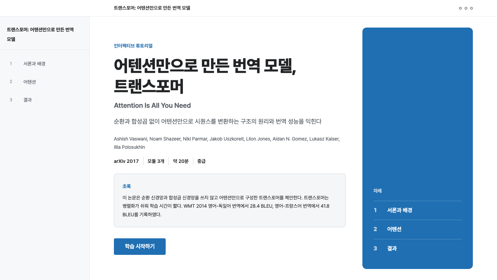
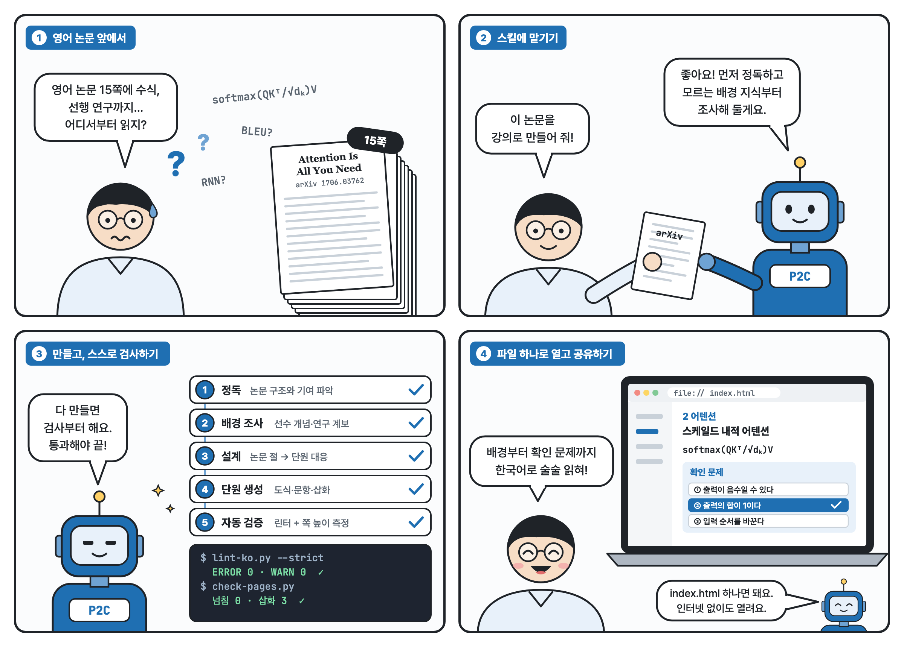
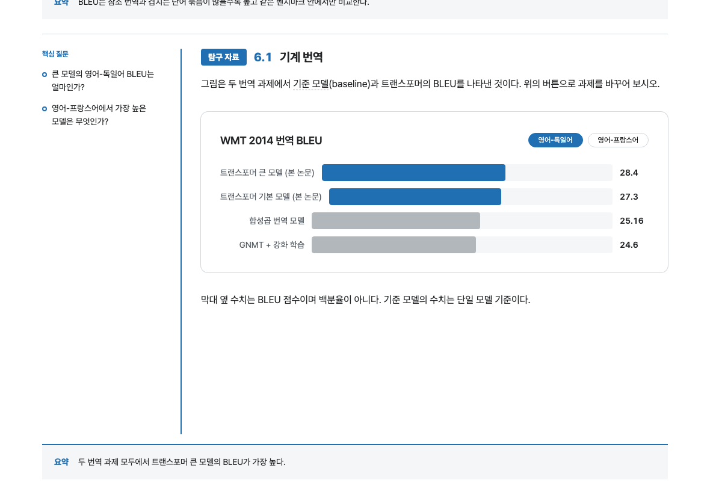

<div align="center">

# Paper-to-Course · Korean Edition

**논문을 검증 가능한 한국어 학습 산출물로 컴파일하는 Claude Code 스킬**

<a href="examples/attention-ko/"></a>


<a href="LICENSE"></a>

<br><br>



<sub>입력: arXiv 1706.03762 · 출력: <a href="examples/attention-ko/"><code>examples/attention-ko/index.html</code></a> (단일 HTML, 서버 불필요)</sub>

</div>

<br>

## 한눈에 보기: 논문 1편 → 강의 1개

<p align="center">
  
</p>

`Attention Is All You Need`(arXiv 1706.03762)를 입력하면 다음 산출물이 생성된다.

| 입력 | 처리 (자동) | 출력 |
|---|---|---|
| arXiv URL 또는 PDF<br>영문 논문 15쪽 | 정독 → 배경 조사 → 설계<br>→ 단원 생성 → 자동 검증 | `index.html` 단일 파일<br>3단원 · 21쪽 · 문항 10개 · 도식 12개 · 삽화 3개 |

| 논문 원문 | 산출 강의에서의 형태 |
|---|---|
| §1 서론: "RNN은 순차 계산이라 병렬화가 어렵다" | 1단원 1쪽: **기존 방식 vs 제안 방식 비교도** + 신규성 3개 요약 |
| §3.2.1 식 (1) $\mathit{softmax}(QK^\top/\sqrt{d_k})V$ | 2단원: 행렬 크기 도식 → **단계별 수식 유도**(스페이스바로 1단계씩) → 의사코드 행별 해설 |
| 표 2 BLEU 28.4 / 41.8 | 3단원: **지표 전환형 결과 비교**, 채점 원리 삽화 |
| 표 3 헤드 수 제거 실험 | 3단원: 헤드 수 1·4·8·16·32 **탭 전환** + 해석 |
| 참고문헌의 선행 연구 | 1단원: **연구 계보 트리**(계승한 것 → 달라진 것, 신규성 표시) |

<br>

## 목적: Why this matters

연구 성과는 논문으로 유통되지만, 논문은 **같은 분야 전문가가 읽는 것을 전제로 쓴 문서**다. 실무에서 논문을 만나는 엔지니어, 임상의, 애널리스트에게는 반복적인 비용(언어, 전제 지식, 검증)이 발생한다.

1. **언어 비용.** 주요 학술지와 학회의 논문은 대부분 영어로 출판된다. 한국어 사용자는 번역과 이해를 동시에 해야 한다.
2. **전제 지식 비용.** 논문은 선수 개념을 설명하지 않는다. 읽는 사람이 계보와 기호 체계를 따로 복원해야 한다.
3. **검증 비용.** LLM에 요약을 맡기면 빠르지만, 결과는 채팅 한 화면에 흩어지고 이해했는지 확인할 장치도, 원문의 어느 절과 대응하는지에 대한 추적성도 없다.

이 스킬의 목표는 **논문 한 편을 비전문가가 체계적으로 학습할 수 있는 산출물로 변환하는 과정을 재현 가능한 파이프라인으로 만드는 것**이다. 핵심 설계 원칙(세 가지)은 다음과 같다:  

| 원칙 | 구현 |
|---|---|
| **Traceability**: 학습 내용이 원문 어디에서 왔는지 항상 보인다 | 모듈은 `1, 2, 3` 연속 번호로 매기고, 화면 제목 끝에 논문 위치를 작은 태그로 남긴다 (`2 어텐션` → `스케일드 내적 어텐션` + `논문 3.2.1절`) |
| **Verifiability**: 생성 결과를 사람이 아니라 도구가 먼저 검사한다 | 한국어 린터 16개 규칙, 헤드리스 브라우저 기반 레이아웃 검사. 둘 다 CI에서 종료 코드로 판정 가능 |
| **Pedagogical grounding**: 형식은 임의로 정하지 않고 검증된 교육 매체에서 가져온다 | 국내 표준 학습서의 지면 구조, 공개된 PDF 학습서(192쪽)에서 측정한 문장 종결 분포 |

LLM이 논문을 "요약"하는 단계는 이미 일상이 되었다. 다음 단계는 **요약이 아닌 고품질의 학습 산출물을, 검증과 함께, 반복 가능하게** 만드는 것이다. 본 저장소는 일련의 단계를 한국어 사용자를 대상으로 구현한 레퍼런스다.

### 이점: 기존 방식과의 비교

| 비교 항목 | 원문 직접 독해 | LLM 채팅 요약 | **본 스킬** |
|---|---|---|---|
| 언어 장벽 | 영어 원문 그대로 | 한국어, 용어 불통일 | 한국어 교재 문체 + **용어표로 번역어 고정**, 통용 영어 개념어는 원어 유지 |
| 선수 지식 | 독자가 별도 조사 | 질문해야만 보충 | **배경 단원 자동 구성**(Attention 예: 벡터·내적, 소프트맥스, 인코더-디코더) |
| 구조 이해 | 그림 1~2개 | 텍스트 위주 | **개념마다 도식**, 전체 구조도, 차이 비교표 |
| 이해 확인 | 없음 | 없음 | **5지선다·`<보기>`형 문항**, 즉시 채점과 오답 분석 |
| 원문 추적 | — | 출처 불명확 | 화면마다 **논문 절 번호 표시** |
| 품질 보증 | — | 검증 불가 | **린터 16개 규칙 + 화면 높이 측정**, 실패 시 종료 코드 1 |
| 재사용성 | — | 대화창에 산재 | **단일 HTML 파일**, 서버·설치 불필요 |

<br>

## What it produces

<p align="center">
  
</p>

입력은 arXiv URL 또는 PDF, 출력은 브라우저에서 바로 여는 `index.html`로 구성하여 End-to-End로 별도의 환경 설정 및 추가 입력 없이 단일 파이프라인으로 산출 가능하도록 구성한다.   

- **Page model.** 화면 하나가 1페이지다. 코넬식 3분할(단서 · 노트 · 요약)을 쓰고, 1440×900 뷰포트에서 스크롤 없이 들어가는지 측정한다 (허용 높이 765px).
- **Structure mirrors the paper.** 모듈 순서와 제목은 논문 목차를 따르고, 번호는 `1, 2, 3 …` 연속 정수로 매긴다. 논문 절 위치는 화면 제목 끝의 `.paper-ref` 태그로 표시한다. 논문에 없는 선수 지식은 별도 모듈로 분리한다.
- **Keyboard paging.** ←→↑↓/PageUp/PageDown/Home/End는 쪽 이동, 스페이스바는 현재 쪽의 주 버튼을 순서대로 실행하며(수식 다음 단계 → 의사코드 다음 줄 → 대화 다음 말풍선 → 전환 버튼·탭 → 확인 문제 정답·해설 공개 → 다음 쪽), Shift+스페이스바는 단계·탭을 되돌린 뒤 이전 쪽으로 간다. 우하단 `‹ n / N ›` 표시로 현재 쪽을 보여 준다. 쪽은 표지, 모듈 첫 페이지, 각 화면 단위이다.
- **Illustrations.** 개념마다 SVG 코드로 그린 도식을 두고, 따로 사물·장면 선화 삽화를 강의마다 3개 이상 넣는다. 삽화는 작은 로컬 모델(SANA-Sprint 0.6B)로 만든 단순한 사물에 화살표·라벨을 SVG로 덧그려, 그림만 보고도 개념의 흐름이 읽히게 한다. `check-pages.py`가 개수를 검사한다.
- **색상 규약.** 색의 역할은 [`references/design-system.md#색상-규약`](references/design-system.md#색상-규약)을 따른다.
- **A figure for every concept.** 새로 도입하는 개념·알고리즘·수식마다 본문 수치와 일치하는 코드 그림을 둔다.
- **Assessment built in.** 개념 체크, 5지선다, `<보기>`형 [3점] 문항을 즉시 채점하고, 해설에는 정답 근거와 대표 오답의 분석을 함께 둔다.
- **Interactive evidence.** 단계별 수식 유도(KaTeX), 의사코드 라인 해설, 지표 전환이 되는 결과 비교, 제거 실험 토글, 연구 계보 트리 등 20종의 요소.

| 확인 문제 | 탐구 자료 |
|:--:|:--:|
|  |  |

<br>

## 사용 절차

**① 설치**: 스킬 디렉터리에 복제한다.

```bash
git clone https://github.com/genelyuu/paper-to-course.git ~/.claude/skills/paper-to-course
```

**② 요청**: Claude Code 세션에서 논문을 지정한다.

```text
https://arxiv.org/abs/1706.03762 강의로 만들어 줘
```

**③ 자동 처리**: 다섯 단계가 순차 실행된다. 각 단계의 산출물은 Attention 예시 기준이다.

| 단계 | 처리 내용 | Attention 예시의 산출물 |
|---|---|---|
| 1. 정독 (Read) | 원문 3회 정독, 수식·결과표·데이터셋 추출 | 식 (1), 표 2(BLEU), 표 3(제거 실험) 목록 |
| 2. 조사 (Ground) | 웹 검색으로 선수 개념·선행 연구·보충 도식 확보 | 선수 개념 4개, 계보(RNN → seq2seq → 어텐션 → Transformer) |
| 3. 설계 (Plan) | 논문 절 → 단원 대응, 강의별 용어표 작성 | 3단원 구성안, `briefs/terms.md` |
| 4. 생성 (Generate) | 단원별 HTML 작성(병렬 하위 에이전트 가능), 삽화 생성 | `modules/00~02`, `assets/fig-*.svg` |
| 5. 검증 (Verify) | `lint-ko.py --strict` + `check-pages.py` 통과 시 완료 | 21쪽 전부 765px 이하, 경고 0건 |

**④ 열람·공유**: 생성된 `index.html`을 브라우저로 연다. 이 파일은 CSS·JS·글꼴·KaTeX·삽화를 모두 안에 넣은 **단독 파일**이라 네트워크 없이 열리고, 이 파일 하나만 보내면 된다(외부 요청 0건).

| 조작 | 기능 |
|---|---|
| `←` `→` `PageUp` `PageDown` `Home` `End` | 쪽 이동 |
| `Space` | 현재 쪽의 다음 동작(수식 다음 단계 → 의사코드 다음 행 → 대화 다음 발화 → 탭 전환 → 정답 공개 → 다음 쪽) |
| `Shift` + `Space` | 직전 동작 취소, 이전 쪽 |

병렬 생성 시 발생하는 용어 불일치는 3단계의 용어표(`briefs/terms.md`)와 243개 항목의 기본 용어 사전(`references/glossary-ko.md`)으로 통일한다.

<br>

## Verification

생성물은 사람이 읽기 전에 두 도구를 통과해야 한다. 둘 다 표준 라이브러리(+ Chrome)만 쓰고, 실패 시 종료 코드 1을 반환한다.

```bash
python3 references/lint-ko.py <course-dir> --strict
python3 references/check-pages.py <course-dir>
```

**`lint-ko.py`**: HTML 파서 기반 한국어 린터. 코드, 수식, 인용된 대화 블록은 검사 범위에서 제외한다.

| 등급 | 규칙 | 검출 대상 |
|---|---|---|
| ERROR | KO001–KO004 | `lang` 누락, 한자 · 중국어 잔존, 전각 문장부호, 깨진 `data-steps` JSON |
| WARN | KO101–KO112 | 문체 혼용, 번역투, 영문 · 숫자 뒤 조사 불일치, 숫자 · 단위 띄어쓰기, 과도한 문단 길이, 칭찬형 해설, 정답 표지 중복, 서술문형 용어 정의, 똑바른 글꼴 수식 |

**`check-pages.py`**: 헤드리스 Chrome으로 렌더링한 후 페이지별 실제 높이를 측정한다. 퀴즈 해설을 **모두 펼친 최대 상태**를 기준으로 하므로, 사용자가 답을 확인한 후에 초과하는 범위도 체크한다.

```text
기준: 1440×900, 페이지 허용 높이 765px
OK   module-1 p1 [코넬] 736px  스케일드 내적 어텐션 논문 3.2.1절
...
요약: 페이지 21개, 넘침 0개, 코넬 아닌 화면 0개, 그림 정렬 문제 0개
```

<br>

## Language model: data-derived style rules

학습서 문체를 공개된 국내 학습서 PDF 3권(192쪽)에서 텍스트를 추출해 문장 종결 유형을 집계했고, **글의 역할마다 종결이 다르게 분포한다**는 규정을 적용한다.

| 역할 | 관측 빈도 | 적용 규칙 | 예 |
|---|--:|---|---|
| 개념 설명 | 한다체 379 | 한다체 평서 | 어텐션은 쿼리와 키의 내적으로 비중을 정한다. |
| 문항 지시 | `~하시오` 120 | `~하시오` | 버튼을 눌러 다음 단계를 보시오. |
| 풀이 전략 | `~하라` 51 | 모듈당 1줄 | 나누는 값을 묻는 문항은 분산이 아니라 그 제곱근인지 확인하라. |
| 용어 정의 | 명사형 34 | 사전식 명사형 (KO111) | 소프트맥스(softmax): 실수 여러 개를 모두 양수이고 합이 1인 값으로 바꾸는 함수. |
| 머리말 · 사용법 | 합니다체 137, 해요체 50 | 미적용 | — |

<sub>정규식 기반 집계로 오차가 있으며 경향 파악 용도다.</sub>

레이아웃 역시 동일한 방식으로 적용한다. 4px 격자는 Carbon · Atlassian · USWDS의 간격 체계를, 지면 구성과 교과 색 프리셋은 국내 학습 교재의 일반적인 스타일(단원 도입 / 날개 / 문항 형식)을 조사해 반영했다 (§8).

<br>

## Differences from upstream

[ZeroxZhang/paper-to-course](https://github.com/ZeroxZhang/paper-to-course)는 중국어 강의를 생성한다. 본 fork는 출력 언어 교체에 그치지 않고 생성 규칙, 지면 모델, 검증 계층을 추가한다.

| | Upstream | This fork |
|---|---|---|
| Output language | zh-CN | ko-KR |
| Structure | 교수법 기준 임의 모듈 | 논문 목차 순서 + 연속 번호, 절 위치는 `.paper-ref` (traceable) |
| Style rules | 없음 | 역할별 종결 규칙, 번역투 · 조사 규칙 |
| Layout | 연속 스크롤, 카드 + 그림자 | 고정 높이 코넬식 페이지, 4px 격자 |
| Assessment | 기본 퀴즈 | 5지선다 · `<보기>`형 · 배점, 오답 분석 해설 |
| Terminology | 없음 | 기본 사전 243개 + 강의별 용어표 |
| Verification | 없음 | 린터 16개 규칙 + 레이아웃 검사 (exit code) |
| Bugs fixed | — | 초기화 순서 오류로 전체 인터랙션이 멈추던 문제, 해설 내 수식 미렌더링, 비백분율 지표의 `%` 표기 |

<br>

## 디렉터리 구조

```text
paper-to-course/
├── SKILL.md                      ★ 스킬 정의: 5단계 절차, 문체·용어·작성 규칙, 점검 목록
├── README.md
├── references/                   스킬이 참조하는 규정·도구 (생성 시 읽거나 실행)
│   ├── 규정 문서
│   │   ├── korean-style-guide.md     문체·조사·띄어쓰기·번역투 규정, 린터 대응표
│   │   ├── glossary-ko.md            AI/ML 용어 사전 (243개 항목)
│   │   ├── design-system.md          디자인 토큰, 색상 규약, 지면 배치
│   │   ├── interactive-elements.md   인터랙티브 요소 20종의 HTML 양식
│   │   ├── illustration.md           도식·삽화 규정 (강의당 삽화 3개 이상)
│   │   ├── content-philosophy.md     내용 구성 원칙
│   │   ├── gotchas.md                생성 시 빈발 오류
│   │   └── module-brief-template.md  단원 설계서 양식
│   ├── 검증 도구
│   │   ├── lint-ko.py                한국어 린터 (16개 규칙)
│   │   └── check-pages.py            화면 높이·도식 정렬·삽화 수 측정
│   ├── 생성 도구
│   │   ├── build.sh, build.py        단원 파일 → 단독 index.html 조립
│   │   └── illustrate.py             로컬 모델 → 선화 SVG (선택, 별도 가상환경)
│   └── 런타임 (산출물에 그대로 복사)
│       ├── _base.html, _footer.html  HTML 골격
│       ├── styles.css, main.js       지면 양식, 쪽 넘김·채점·단계 진행
│       └── vendor/                   빌드 시 내장되는 자원: 글꼴(P2C Sans·JetBrains Mono), KaTeX
├── examples/
│   └── attention-ko/             ★ 참조 산출물 (Attention Is All You Need)
│       ├── index.html                최종 산출물 (build.sh가 생성한 단독 파일)
│       ├── _cover.html               표지: 제목, 초록, 목차
│       ├── modules/
│       │   ├── 00-background.html    1단원 서론과 배경 (9쪽)
│       │   ├── 01-attention.html     2단원 어텐션 (7쪽)
│       │   └── 02-results.html       3단원 결과 (5쪽)
│       ├── assets/fig-*.svg          삽화 3개 (+ 재현용 생성 조건 .json)
│       ├── briefs/terms.md           강의별 용어표
│       └── styles.css, main.js       references/에서 복사한 런타임
└── docs/
    ├── images/                   README 화면 캡처
    └── lint-fixtures/            린터 검증용 정상·오류 예시
```

생성된 강의는 `examples/attention-ko/`와 동일한 구조를 갖는다. 단원 하나가 `modules/` 아래 파일 하나에 대응하므로, 특정 단원만 수정한 뒤 `build.sh`로 재조립할 수 있다.

<br>

## Limitations

- 레이아웃 검사는 데스크톱 1440×900 기준이다. 1200px 미만에서는 1단으로 전환되며 페이지 단위 보장을 하지 않는다.
- 본문 글꼴은 KS X 1001 한글 2,350자 범위다. 그 밖의 글자는 시스템 글꼴로 표시된다.
- 생성 품질은 원문 해석에 의존한다. 린터와 레이아웃 검사는 형식을 보장하지만 내용의 정확성은 보장하지 않는다.

<br>

---

<div align="center">
<sub>
Upstream <a href="https://github.com/ZeroxZhang/paper-to-course">ZeroxZhang/paper-to-course</a> (now <a href="https://github.com/ZeroxZhang/zerox-skills/tree/main/zerox-paper-to-course">zerox-skills</a>) ·
Inspired by <a href="https://github.com/zarazhangrui/codebase-to-course">codebase-to-course</a> ·
<a href="LICENSE">Apache License 2.0</a>
</sub>
</div>
